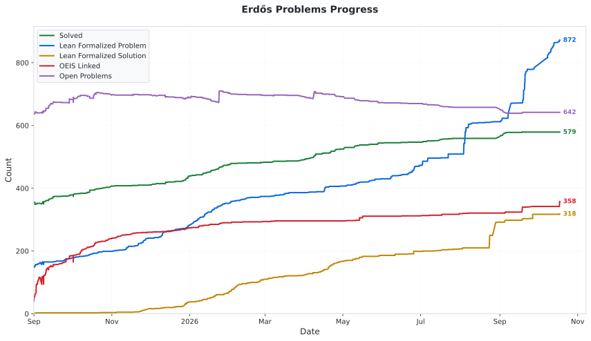

# Progress chart

This page displays a progress chart regenerated from the [history CSV](data/statistics_history.csv) in the [manman4 fork](https://github.com/manman4/erdosproblems). The latest entry in this rendering is **October 17, 2026, 22:23:22 UTC** (October 18 in Japan).

<picture>
  <source media="(prefers-color-scheme: dark)" srcset="data/fork_statistics_history_dark.svg">
  <source media="(prefers-color-scheme: light)" srcset="data/fork_statistics_history_light.svg">
  
</picture>

Open the image directly: [light theme](data/fork_statistics_history_light.svg) / [dark theme](data/fork_statistics_history_dark.svg).

To refresh these images after the CSV changes, run `python scripts/plot_fork_statistics_history.py` and update the rendering date above. This uses the existing plotting code with `force=True` and writes separate fork images.

The upstream chart remains frozen as of October 6, 2026: [light theme](data/statistics_history_light.svg) / [dark theme](data/statistics_history_dark.svg). See the [README](README.md#progress) for that policy.

Back to [summary statistics](STATISTICS.md) or the [problem table](README.md#table).
