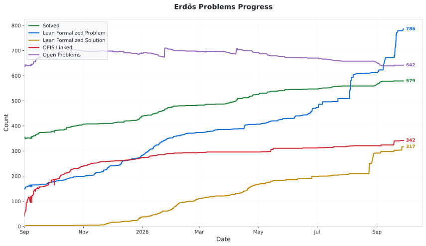

# Progress chart archive

This page preserves the progress chart in the [manman4 fork](https://github.com/manman4/erdosproblems). The chart is frozen as of **October 6, 2026**, following the upstream policy described in the [README](README.md#progress).

<picture>
  <source media="(prefers-color-scheme: dark)" srcset="data/statistics_history_dark.svg">
  <source media="(prefers-color-scheme: light)" srcset="data/statistics_history_light.svg">
  
</picture>

Open the image directly: [light theme](data/statistics_history_light.svg) / [dark theme](data/statistics_history_dark.svg).

The [history CSV](data/statistics_history.csv) continues to be updated; it can contain entries newer than this archived chart.

Back to [summary statistics](STATISTICS.md) or the [problem table](README.md#table).
